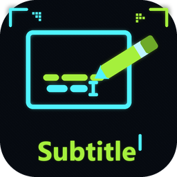
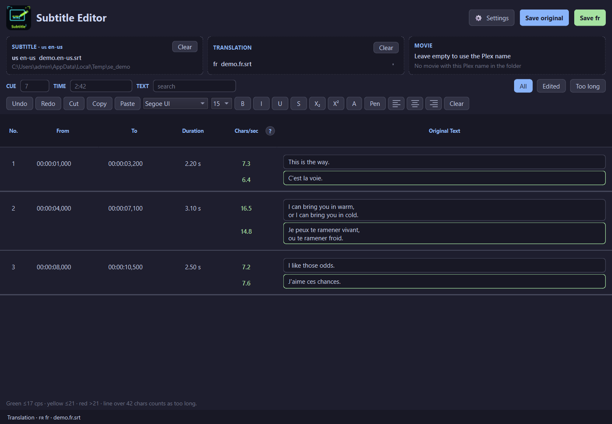
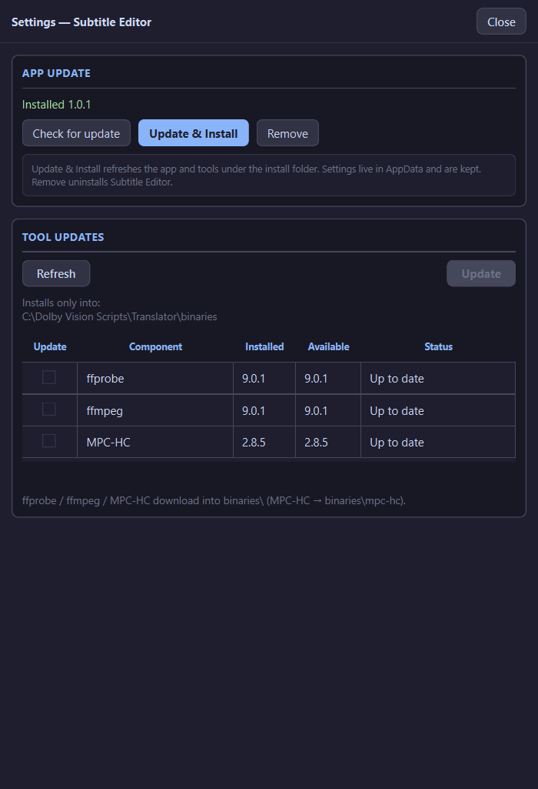

# Subtitle Editor

  

  
  
  
  

---

## What is Subtitle Editor?

**Subtitle Editor is a cue-by-cue SRT editor** for original lines plus up to **3 translations** at once — with reading-speed (chars/sec) colors and an optional **View** pane that plays the cue in embedded **MPC-HC**.

Drop the original SRT (Plex language tag), drop translation SRTs, edit in the table, hit **Save**. Open **View** on a cue to hear/see that span with Before/After padding, then pause. No separate K-Lite or Python install — Setup ships MPC-HC + ffprobe into `{app}\binaries`.

### What you get

| Piece | In plain words |
|------|----------------|
| **Cue table** | No. / From / To / Duration / Chars/sec / text — edit original + each translation in-row |
| **Chars/sec** | Green ≤17 · yellow ≤21 · red >21. Lines over 42 chars count as Too long |
| **Translations** | Up to 3 SRTs (fr / de / es …) listed under the original in the same cue |
| **View** | Side MPC-HC Tool window — play the selected cue, then pause; Replay uses the same span |
| **Settings** | App update + Tool updates (ffprobe / ffmpeg / MPC-HC) into `{app}\binaries` |

---

## Screenshots

  

<em>Main window — original + translation cues, chars/sec, Save, View.</em>

  

<em>Settings — App update and Tool updates (ffprobe / ffmpeg / MPC-HC).</em>

---

## How to use (quick start)

1. Install from [Releases](https://github.com/aberthil/SubtitleEditor-releases/releases/latest) and open **Subtitle Editor**.
2. Drop the **original** SRT (Plex `en-us` / `en` style name works best for movie match).
3. Drop up to **3 translation** SRTs into the Translation box.
4. Optional: drop a **movie**, or leave it empty to match the Plex basename beside the subtitle.
5. Edit cues in the table. Use **View** to play that cue. **Save original** / **Save fr** / … writes each file.

**Settings** (top-right) is a Tool window beside the main window — App update and Tool updates live there.

---

## Download

| | |
|--|--|
| **Latest Setup** | [SubtitleEditor-1.0.3-Setup.exe](https://github.com/aberthil/SubtitleEditor-releases/releases/latest/download/SubtitleEditor-1.0.3-Setup.exe) |
| **All versions** | [Releases](https://github.com/aberthil/SubtitleEditor-releases/releases) |
| **SHA-256** | [SubtitleEditor-1.0.3-Setup.exe.sha256](https://github.com/aberthil/SubtitleEditor-releases/releases/latest/download/SubtitleEditor-1.0.3-Setup.exe.sha256) |

> Prefer the **latest** tag always:  
> https://github.com/aberthil/SubtitleEditor-releases/releases/latest

Installs to `C:\DolbyVisionScripts\SubtitleEditor` by default. Settings live in AppData and **survive App Update**. Only a full **Remove** wipes them.

Setup includes owned **MPC-HC** (`binaries\mpc-hc`) and **ffprobe** — View works out of the box.

---

## Requirements

| | |
|--|--|
| OS | Windows 10/11 **x64** |
| Disk | ~150 MB install + room for your SRTs / movie |
| GPU | Not required (View uses MPC-HC / LAV from the owned binaries tree) |

---

## Install

1. Download **SubtitleEditor-*-Setup.exe** from [Releases](https://github.com/aberthil/SubtitleEditor-releases/releases/latest)
2. Run Setup (admin)
3. Launch **Subtitle Editor** from the Finish page / Start Menu

**Update the app:** Settings → Check for update / Update && Install  
(keeps AppData userdata; Tool updates ≠ App update)

---

## What's New

### v1.0.3

- Readable cue text (strip font/ASS wrappers), fixed cue No. clipping, clearer View/MPC errors

### v1.0.2

- Fix installed exe crash: missing `http.server` in the freeze

### v1.0.1

- Settings as a MuxLab-style Tool window beside main
- No post-map HWND jitter on launch / Settings open
- Tool Updates Refresh no longer flashes ffprobe/ffmpeg console windows

See [Releases](https://github.com/aberthil/SubtitleEditor-releases/releases) for each Setup's notes.

---

## Links

- **Latest download:** https://github.com/aberthil/SubtitleEditor-releases/releases/latest
- **This repo:** public Setup hosting + project page (source stays private)

---

## License / support

Windows installers for end users. Problems with a specific Setup: note the release tag and contact the publisher (`aberthil`).
